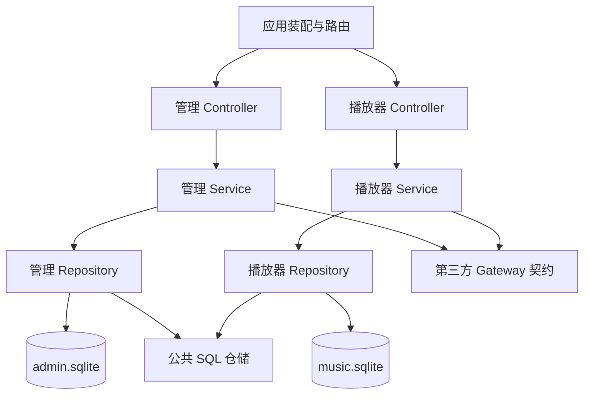

# Node 分层与持久化设计

作者：yahyaoo

## 设计约束

参考 `D:/code/qdgw` 的 Controller → Service → Mapper/Repository 和公共模型约定。Node 保持原 HTTP、WebSocket、Subsonic、音源选择、歌曲排序、下载及缓存协议。分层调整不改变原接口必填参数、状态码、授权条件或响应字段。设置增加 JSON 迁移入口，持久化改为 SQLite。

`src` 是服务源码，`server` 是构建输出，不能直接修改输出。播放器页面位于 `client/music`。本轮系统配置页面位于 `client/views/system-configuration`，使用设置目录组织管理表单。

## 目录职责

| 目录 | 职责 |
| --- | --- |
| `server/application` | 应用装配、原 HTTP 路由顺序、数据库实例生命周期和旧持久化协议适配 |
| `server/admin/controller` | 管理 HTTP 入口；交给对应服务 |
| `server/admin/service` | 用户、源注册、管理配置、运维与备份业务 |
| `server/admin/repository` | 管理库表注册与连接工厂 |
| `server/music/controller` | 播放器 HTTP 入口与上传/浏览器存储请求校验 |
| `server/music/service` | 歌单、屏蔽规则、媒体库、发现、音效、下载、缓存、任务与 Subsonic |
| `server/music/repository` | 播放器库及配置导入、浏览器存储仓储 |
| `server/*/model/entity` | 每张业务表的存储实体 |
| `server/*/model/dto` | 数据写入参数；不引入原接口必填字段 |
| `server/*/model/vo` | 数据访问返回模型；原 HTTP 响应仍使用既有结构 |
| `server/common` | 公共字段、请求上下文、令牌契约、通用 SQLite 文档仓储 |
| `server/integrations` | 第三方音乐平台、脚本执行、更新查询、压缩包适配 |
| `sql/admin`、`sql/music` | 两库各自的建表 SQL |

所有命名保持类/模型 PascalCase、方法 camelCase、模块职责明确。SQL 表和列采用小写下划线，管理表前缀 `admin_`，播放器表前缀 `music_`。JSDoc 描述使用中文，作者 `yahyaoo`。

## 调用边界



两个业务域不直接导入对方代码，不共享数据库连接、业务表或跨库事务。共用无业务归属的基础设施和应用装配入口。播放器既有鉴权仍由装配层注入；两个域的用户名称关联沿用原身份协议。

原 160 个路由的处理块移动到相应 Service，Controller 保持薄包装。服务使用 `Pick<ServerRuntime, ...>` 收窄依赖。为保留原异步回调与错误响应，旧服务仍接收 HTTP 上下文；新增导入与浏览器存储业务服务不持有响应对象。旧 `server/server`、`server/modules` 路径保留重导出入口，便于既有脚本兼容。

## 第三方接口

`MusicGateway` 保留原 SDK 对象身份和平台能力；`NetworkGateway` 保留请求取消与代理处理；`CustomSourceGateway` 处理脚本元信息、装载和播放地址；`UpdateGateway` 保留版本比较和服务器地址规则；`WebDavGateway` 提供远程备份能力；`ArchiveGateway` 接收注入的存储契约。业务不导入音乐 SDK 的 `internal` 文件。

SDK 内部算法与平台协议继续使用原实现。动态平台扩展能力保留开放类型，避免通过“类型整理”删掉未知字段或取消请求对象。

## 持久化与模型

管理库和播放器库默认分别位于 `DATA_PATH/database/admin.sqlite`、`DATA_PATH/database/music.sqlite`；引导文件可指定独立位置，应用层负责迁移和切换。业务配置仅存管理库，详见 [系统配置说明](./system-configuration.md)。两库各有自己的 `server_storage_document` / `client_storage_document` 元数据表。使用 WAL、外键开关和 5 秒忙等待；所有值参数绑定，表名仅允许使用注册常量。

业务实体继承 `BaseEntity`：`documentKey`、`recordKey`、`sortOrder`、`valueJson`、`createdAt`、`updatedAt` 分别映射同名下划线 SQL 列。联合主键是作用域和记录键。数组按元素拆行，对象按顶层属性拆行，标量单行保存。未知平台字段、嵌套结构、重复歌曲和顺序保持原值。这里采用有序文档记录模型，避免引入歌曲去重、主键重编或关系重建改变业务含义。

`server_storage_document` / `client_storage_document` 保存顶层类型、原文本、时间、字节数和有效标记，使导出字节、快照时间、空文档及删除行为仍与原协议兼容。原文件编辑器允许保存空文本/未完成 JSON，使用 `text` 类型保留；配置上传单独严格校验。

内部文档键使用 `data:相对路径`，搬动整个数据目录后仍能读取。数据目录外的自定义缓存/快照保留绝对位置，不自动搬移外部音乐文件。

`documentFileSystem` 是显式导入的持久化适配器，不修改全局 `fs`。它保持原读写、删除、流、统计、枚举和临时文件改名约定，底层由 Repository 执行 SQL。音频、封面、歌词、脚本、静态资源继续使用文件系统。新配置导入通过独立仓储事务直接操作 SQL。

## 运行和验证

```text
npm install
npm run build
npm run test:unit
npm run test:system
npm run test:fpk
npm start
```

构建将 SQL 复制到 `server/sql`，飞牛载荷与桌面应用跟随输出包含 DDL。`better-sqlite3` 是原生依赖；Docker 生产安装需要重建该模块，Electron 打包需要按 Electron ABI 重建。平台安装包仍需在对应目标系统验证。

`test/fixtures/route-refactor.json` 固定原 160 个处理块的语法摘要和条件顺序。回归忽略注释、TypeScript 类型和允许的模块重定位，核对编译后的执行语句。另有两域依赖边界、SQL 回滚、旧数据迁移、目录搬移、备份和浏览器离线重试测试。系统测试使用临时目录、随机可访问端口和本地测试音源，不修改已有运行实例的数据。

## B 组音乐库后台装配（2026-10-13）

HTTP 应用入口装配 `LibraryBackgroundService`：启动共享元数据 worker、预取器、自动维护服务和唯一扫描调度器，关闭时先停止自动写/预取入场，再等待扫描与保存、释放 worker。配置域通过 `createServerRuntime().refreshLibraryBackground` 注入能力刷新后台，避免 admin 直接导入 music 实现。管理状态路由在应用入口分派，全部验证管理员凭据。

`LibraryScanScheduler` 复用 `SchedulerService` 的一分钟判断任务及注销接口。`LibraryWatcher` 使用原生 fs.watch，防抖后排 paths，丢失定位/溢出转 full；网络盘或失败时降级。`CustomMusicService` 的全服务 Promise 队列执行 quick/full/paths，worker 按目录 mtime 剪枝，并按目录分组旧索引以避免重复全表遍历。索引提交沿用 SQLite 事务，媒体状态用 merge/flush 合并，提交前重核目录配置，列表读取不启动扫描。

`ArtworkLyricPrefetcher` 订阅 C 组创建的进程内 ServerEvents，使用有界队列、用户轮转和资源 fingerprint。共享两个元数据 worker，前台读队列优先；网络串行限速、失败退避；本地 .lrc/内嵌歌词写入只读媒体缓存。资源 ETag 在认证后处理，正确版本 URL 才允许 private 一周缓存。事件中的文件数组留在进程内，03 负责转成轻量 WS 摘要；B 不改 ClientChannel。

`LibraryAutoFixService` 将可信候选交原 `MusicMaintenanceService → MusicTaskService → MusicMaintenanceWorker` 管道，默认动作 off。自动写采用同目录副本、标签/压缩音频载荷/时长读回校验、提交授权、原文件 fingerprint 重核、fsync 与单次 rename；失败保留原件，未提交暂存清理。仅私有缓存的已验证格式可自动写，custom/location=custom 与独立 Subsonic 端口保守跳过。主 HTTP 音频响应期间有粗粒度读取保护，手动任务保持原默认行为；安全写失败和跳过可查独立审计。

未验收的边界包括 fnOS/真实网络挂载可靠性、真实媒体负载 P95、浏览器配置交互及电源故障后的持久性。2 万条索引序列化和 SQLite 提交仍为同步开销，单次测量约 596ms，不能据 worker 化宣称主线程后台预算已达标。具体合并边界与验证见 `docs/plans/04-*`、`05-*`、`06-*` 的执行记录。
